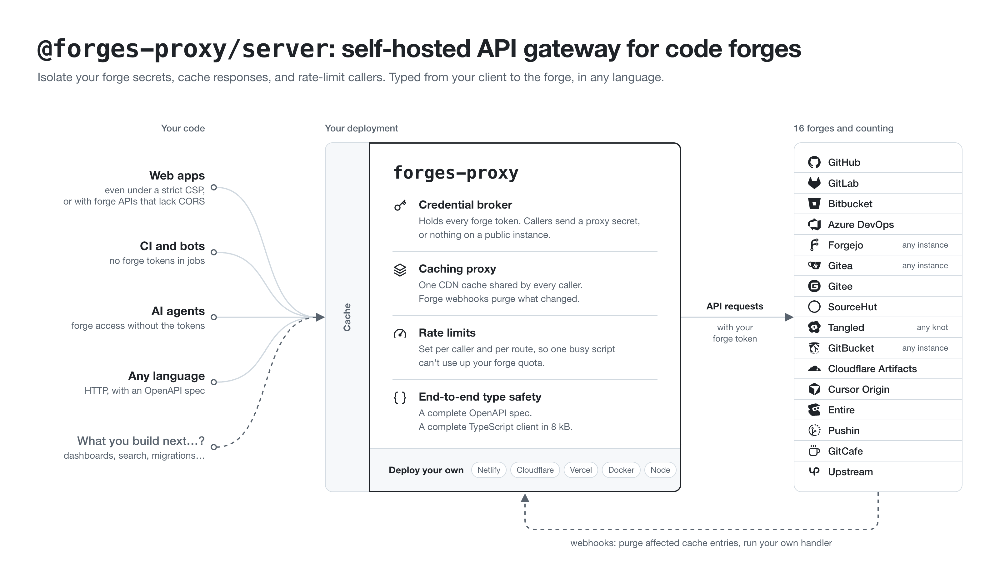
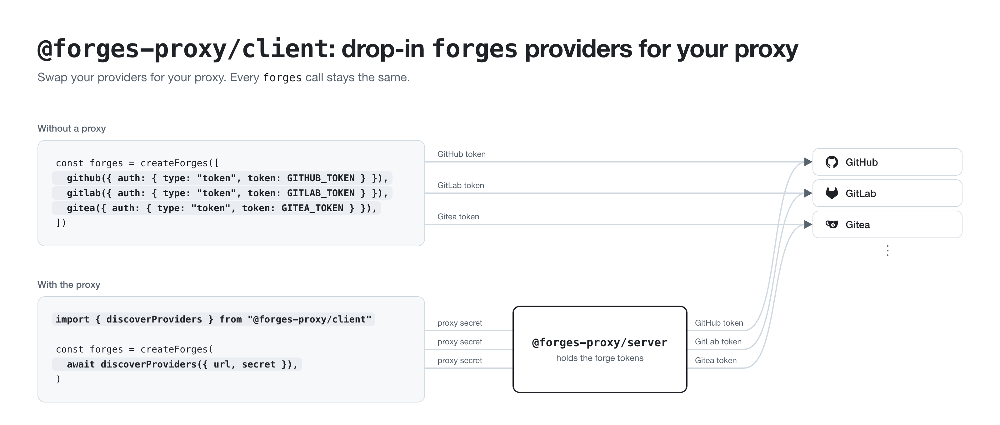

# forges-proxy

A self-hosted HTTP proxy and credential broker for [`forges`](https://forges.link). It holds your
forge tokens, caches public reads at the CDN, and exposes a single HTTP API across all configured
forges.

<picture>
  <source media="(prefers-color-scheme: dark)" srcset="assets/server-dark.png">
  
</picture>

## Use cases

- Calling `forges` from non-JS languages over HTTP, either as a sidecar or a shared gateway.
- Sharing forge credentials and pooling rate limits behind a single cache for internal tools, bots,
  and CI jobs.
- Public read-only apps like [npmx](https://npmx.dev), where many readers query multiple forges
  through a shared CDN cache.
- Browsers and sandboxes with strict CSP or egress allowlists that need to reach arbitrary forge
  hosts (such as Tangled user servers and knots, self-hosted instances, or Radicle nodes).
- Giving AI agents forge access without exposing raw forge tokens.

## Packages

- [`packages/server`](packages/server) (`@forges-proxy/server`): the proxy server, exported as a
  [Fetchable](https://fetchable.org) (`{ fetch(request) }`). Use `createServer(options)` for custom
  configuration, or the default export to configure from `process.env`.
- [`packages/client`](packages/client) (`@forges-proxy/client`): `discoverProviders()`, which wraps
  a remote proxy in standard `forges` provider objects.
- [`packages/docs`](packages/docs): placeholder for the documentation site.
- [`demos/`](demos): example deployments for supported platforms and frameworks.

## Demos

The framework demos mount the proxy under `/forges`. The live deployments below are public,
read-only instances.

| Demo                                           | Live                                                                                  |
| ---------------------------------------------- | ------------------------------------------------------------------------------------- |
| [Netlify Functions](demos/netlify-serverless)  | [forges-proxy-demo.netlify.app](https://forges-proxy-demo.netlify.app/)               |
| [Netlify Edge Functions](demos/netlify-edge)   | [forges-proxy-edge-demo.netlify.app](https://forges-proxy-edge-demo.netlify.app/)     |
| [Netlify Server](demos/netlify-server)         | [forges-proxy-server-demo.netlify.app](https://forges-proxy-server-demo.netlify.app/) |
| [Cloudflare Workers](demos/cloudflare-workers) | [demo.forges-proxy.workers.dev](https://demo.forges-proxy.workers.dev/)               |
| [Vercel](demos/vercel)                         | [forges-proxy-demo.vercel.app](https://forges-proxy-demo.vercel.app/)                 |
| [Docker](demos/docker)                         | [forges-proxy-demo.fly.dev](https://forges-proxy-demo.fly.dev/) (Fly.io)              |
| [Node](demos/node)                             |                                                                                       |
| [Hono](demos/hono)                             |                                                                                       |
| [Nitro](demos/nitro)                           |                                                                                       |
| [Fastify](demos/fastify)                       |                                                                                       |

## Deploy

Install `@forges-proxy/server` and export it from your platform entrypoint. On platforms that accept
a Fetchable directly:

```ts
export { default } from "@forges-proxy/server"
```

Pass platform-specific hooks like CDN cache headers and tag purging to `createServer()`. For
example, on Netlify Functions:

```ts
import { createServer } from "@forges-proxy/server"
import { purgeCache } from "@netlify/functions"

export default createServer({
  purge: (tags) => purgeCache({ tags }),
  cdnHeaders: ({ cacheControl, tags }) => ({
    "netlify-cdn-cache-control": `${cacheControl}, durable`,
    "netlify-cache-tag": tags.join(","),
  }),
})
export const config = { path: "/*" }
```

The server expects requests rooted at `/`. If you mount it under a subpath, strip the prefix before
passing the request to `server.fetch` (Hono's `app.mount()` does this automatically). The client,
`/docs`, and `/openapi.json` all work under a path prefix.

Run `pnpm smoke <url> [secret]` to verify a deployed instance end-to-end.

## Configure

Providers are configured with `FORGES_<KIND>_<FIELD>[_<SUFFIX>]` environment variables, using the
same format as `forgesFromEnv()` (for example, `FORGES_GITHUB_TOKEN` or `FORGES_GITLAB_ENABLED=1`).

If you pass `createServer({ anonymousForges: true })`, any forge not configured in the environment
that supports unauthenticated reads at its default host is also enabled anonymously (currently
GitHub, GitLab, Codeberg, gitea.com, Bitbucket, Gitee, Cursor Origin, Pushin, GitCafe, and
Upstream). Tangled is excluded because its reads fetch hosts specified in caller arguments, which
would create an SSRF risk without an egress allowlist. All demos enable `anonymousForges`.

You must set either `FORGES_PROXY_SECRET` or `FORGES_PROXY_PUBLIC=1`:

- `FORGES_PROXY_SECRET`: runs a private instance. All endpoints except `/docs`, `/openapi.json`, and
  `/webhooks/*` require `Authorization: Bearer <secret>`. All routable verbs are enabled. To rotate
  secrets without downtime, set `FORGES_PROXY_PREVIOUS_SECRET` to the old secret and
  `FORGES_PROXY_SECRET` to the new one; both are accepted until you unset
  `FORGES_PROXY_PREVIOUS_SECRET`.
- `FORGES_PROXY_PUBLIC=1`: runs a public, read-only instance with no authentication. Write verbs,
  account verbs, and privileged reads (security alerts, collaborators, branch rules) are disabled.
  Any forge tokens configured on a public instance must be scoped to public data only (for example,
  a fine-grained GitHub token with public-only access).

## Use

```sh
pnpm install
FORGES_PROXY_PUBLIC=1 FORGES_GITHUB_ENABLED=1 pnpm --filter @forges-proxy/server dev
```

This starts a local public instance serving GitHub anonymously. Set `FORGES_GITHUB_TOKEN` for higher
rate limits.

### Endpoints

- `GET /`: returns the access mode, `forges` version, configured providers and their capabilities
  (refreshed once per server instance), and routed verbs with their options parameter index.
- `GET /docs`: interactive Scalar API reference built from `GET /openapi.json` (OpenAPI 3.1).
- `GET /status`: latest rate-limit budgets observed by the responding server instance. Uncached verb
  responses also include this data in the `forges-rate-limits` header.
- `GET /:forge/:instance/:verb?args=<json array>`: calls a read verb (e.g. `repos.get`,
  `threads.list`).
- `POST /:forge/:instance/:verb` with `{ "args": [...] }`: calls a write verb.
- `GET /:forge/:instance/sources.stream`: streams live events from `provider.sources.stream()`
  (currently Tangled only) as
  [Server-Sent Events](https://developer.mozilla.org/en-US/docs/Web/API/Server-sent_events). Each
  event's `id` is its cursor; pass `Last-Event-ID` or `?cursor=` to resume. Errors emit an `error`
  event before closing. Serverless platforms terminate long-lived connections at their execution
  time limit, so clients should reconnect using the last seen cursor. Browser `EventSource` does not
  support custom `Authorization` headers; use `@forges-proxy/client` or `fetch` against private
  instances.

`args` is a JSON array of positional arguments matching the `ForgeProvider` method signature (see
`/docs`), validated against the operation schema. Use `null` to skip an optional positional
argument. Binary values are encoded as `{ "$bytes": "<base64>" }` and dates as
`{ "$date": "<ISO 8601>" }`.

Listing endpoints return a single page (`{ items, cursor }`). Pass `cursor` back in the options
argument to fetch the next page. On public instances with authenticated providers, the proxy
HMAC-signs `cursor.nextUrl` and rejects unsigned or tampered URLs.

```sh
curl -G localhost:3000/github/github.com/repos.get \
  --data-urlencode 'args=[{"forge":"github","instance":"github.com","owner":"danielroe","name":"forges"}]'
```

## Client

<picture>
  <source media="(prefers-color-scheme: dark)" srcset="assets/client-dark.png">
  
</picture>

`@forges-proxy/client` connects to a proxy and returns `ForgeProvider` instances that plug directly
into `createForges()`:

```ts
import { createForges } from "forges"
import { discoverProviders } from "@forges-proxy/client"

const forges = createForges(await discoverProviders({ url: "https://forges.example.com", secret }))
const repo = await forges.repos.get({
  forge: "github",
  instance: "github.com",
  owner: "danielroe",
  name: "forges",
})
```

`discoverProviders()` fetches `GET /` on startup. To avoid fetching `GET /` on every server request
or in the browser after SSR, fetch the index once with `fetchProxyIndex()` and pass it via `index`:

```ts
import { discoverProviders, fetchProxyIndex } from "@forges-proxy/client"

const index = await fetchProxyIndex({ url, secret })
// Reuse `index` across requests with each caller's `fetch`:
const providers = await discoverProviders({ url, secret, index, fetch })
```

Requests to the proxy time out after `timeout` milliseconds (default `30000`); `sources.stream()`
connections do not time out.

Synchronous helper methods (`urlFor()`, `parseUrl()`, `referenceFor()`, etc.) run locally and
require the underlying provider factory. Pass the factories you need via `factories` to avoid
bundling unused forges, or pass `allFactories` from `@forges-proxy/client/all` to include all of
them:

```ts
import { github } from "forges/github"

const providers = await discoverProviders({ url, secret, factories: [github] })
```

If no factory is provided for a forge, its synchronous helpers return `undefined` (or `[]` / the
input string).

Listings fetch one page per HTTP request whether you iterate with `for await` or call `.page()`.
`sources.stream()` reads the SSE endpoint and throws `StreamClosedError` (with the last cursor
attached) when the connection closes so you can resume. Upstream errors are reconstructed into their
original `ForgeError` subclasses. Unrouted verbs reject with `UnsupportedOperationError` and report
`false` from `can()`. Call `refreshCapabilities()` to re-fetch provider capabilities from `GET /`.

`rateLimits()` returns the budgets attached to the provider's most recent response. Note that:

- Budgets reflect the state of the server instance that handled the request, not per-client state.
  In serverless deployments, each instance tracks budgets independently.
- Authenticated budgets belong to the proxy's forge token/installation and are shared across all
  callers. Anonymous budgets are typically tied to the server instance's egress IP.
- On public instances, cacheable read responses omit the `forges-rate-limits` header so the CDN does
  not serve stale budgets; `rateLimits()` only updates on error responses. Query `GET /status` for
  current budgets.
- Secondary rate limits that forges do not report via response headers are not included.

## Webhooks

Pointing forge webhooks at the proxy lets it purge cached CDN responses when repositories change and
forward normalized events to your code.

Without webhooks, cached public reads expire via TTL (`max-age=60, stale-while-revalidate=600`).
When you configure `purge` in `createServer()` (as in the Netlify Functions and Netlify Server
demos), each verified webhook delivery purges the cache tags for every repository affected by the
delivery.

If you also pass `handleEvents`, the proxy calls it after purging with the normalized
[`ForgeEvent`s](https://forges.link/concepts/events) and the `{ forge, instance }` source:

```ts
createServer({
  handleEvents: async (events, { forge, instance }) => {
    await queue.send(events)
  },
})
```

The webhook route awaits `handleEvents`. If it throws, the proxy logs the error and returns `500` so
the failure is recorded in the forge's webhook delivery log. Most forges do not automatically retry
failed deliveries, so you can redeliver from the forge UI or via `webhooks.redeliver()` on private
instances. Because forges time out webhook deliveries after a few seconds (10s on GitHub), offload
slow work to a queue or `waitUntil`.

### Webhook setup

1. Generate a webhook secret and set `FORGES_<KIND>_WEBHOOK_SECRET` (e.g.
   `FORGES_GITHUB_WEBHOOK_SECRET`). Note that setting any `FORGES_<KIND>_*` variable disables the
   `anonymousForges` fallback for that forge, so if you are not setting a token on a public
   instance, also set `FORGES_<KIND>_ENABLED=1`.
2. In your forge's repository or organization settings (or via
   [`webhooks.create()`](https://forges.link/guides/webhooks#register-a-webhook)), register a
   webhook pointing to `https://<proxy>/webhooks/<forge>/<instance>` (e.g.
   `/webhooks/github/github.com`) with a JSON payload and the same secret. Subscribing to all events
   ensures all repository changes purge the cache.
3. Verify in the forge's delivery log: valid deliveries return `200` with `{ "purged": [...] }`,
   invalid signatures return `401`, and unconfigured providers return `404`.

Webhook endpoints do not use `FORGES_PROXY_SECRET`; deliveries are authenticated using the forge's
webhook signature. See the `forges` [webhooks guide](https://forges.link/guides/webhooks) and
[provider docs](https://forges.link/providers) for per-forge signature and event details.

## Upstream requests

Public reads are cached at the CDN, while cache misses make upstream requests to the forge. To add
an upstream HTTP cache beneath the provider, pass a custom `fetch` implementation to
`createServer({ fetch })`.

## Logging

By default, the server only logs unhandled errors and `handleEvents` failures to `console.error`.
Pass a `logger` object (`{ error(event), info?(event) }`) to `createServer()` to route error logs
and emit a structured `info` log on every request
(`{ message: "request", method, path, status, durationMs }`). `console`, pino, and
[evlog](https://evlog.dev)'s `log` all match this interface. Pass the logger object itself rather
than unbound methods so `this` is preserved. Requests served directly by the CDN do not reach the
server and are not logged.

## Operations manifest

`packages/server/src/manifest.ts` re-exports the verb signatures and model schemas from
`forges/schema`. Request validation, signal injection, and `/openapi.json` are all driven by this
manifest. Bumping the `forges` dependency picks up new verbs automatically.
