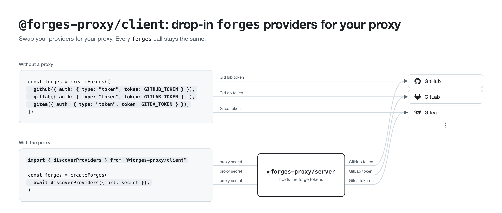

# @forges-proxy/client

<picture>
  <source media="(prefers-color-scheme: dark)" srcset="https://raw.githubusercontent.com/serhalp/forges-proxy/main/assets/client-dark.png">
  
</picture>

Connects to a [`@forges-proxy/server`](https://github.com/serhalp/forges-proxy) deployment and
returns drop-in [`forges`](https://forges.link) providers.

## Install

```sh
pnpm add @forges-proxy/client forges
```

## Every forge: `discoverProviders()`

```ts
import { createForges } from "forges"
import { discoverProviders } from "@forges-proxy/client"

const forges = createForges(await discoverProviders({ url: "https://forges.example.com", secret }))
```

`discoverProviders()` returns a provider for every forge configured on the proxy (needed for
cross-forge calls like `forges.search.threads()`). By default it fetches `GET /_meta` on startup. To
avoid fetching `GET /_meta` on every server request or in the browser after SSR, fetch the proxy's
metadata once with `fetchProxyMeta()` and pass it in:

```ts
import { discoverProviders, fetchProxyMeta } from "@forges-proxy/client"

const meta = await fetchProxyMeta({ url, secret })
// Reuse `meta` across requests with each caller's `fetch`:
const providers = await discoverProviders({ url, secret, meta, fetch })
```

## One forge: `proxyProvider()`

If you already know which forge you want to call, `proxyProvider()` constructs its provider
synchronously without fetching `GET /_meta`:

```ts
import { proxyProvider } from "@forges-proxy/client"

const github = proxyProvider({ url, secret, forge: "github" })
const repo = await github.repos.get({ forge: "github", instance: "github.com", owner, name })
```

Until `refreshCapabilities()` is called to fetch `GET /_meta`, `proxyProvider()` optimistically
reports all verbs as supported from `can()`, and any verb not routed by the proxy rejects with
`UnsupportedOperationError` when called. For self-hosted instances, pass `baseUrl` or `instance`.

## Timeouts

Requests to the proxy time out after `timeout` milliseconds (default `30000`); `sources.stream()`
connections do not time out.

## Synchronous helpers

Web link helpers (`urlFor()`, `parseUrl()`, `referenceFor()`, `parseReferences()`, `webOrigin`) are
built in via `forges/web`. Other synchronous helpers (`normaliseMarkdown()`, `scopesFor()`,
`webhooks.events`, and link helpers for Cloudflare Artifacts and Cursor Origin) require the forge's
provider factory. Pass only the factories you need via `factories`, or pass `allFactories` from
`@forges-proxy/client/all` to bundle all forges:

```ts
import { github } from "forges/github"

const providers = await discoverProviders({ url, secret, factories: [github] })
```

## Listings, errors, and versions

Listings fetch one page per HTTP request, upstream errors are reconstructed into their `ForgeError`
subclasses, and verbs not routed by the proxy reject with `UnsupportedOperationError`. When the
proxy runs a `forges` with another wire format, the client warns once; pass
`versionMismatch: "throw"` to fail instead. `proxyProvider()` checks the version the proxy reports
on its first response.
