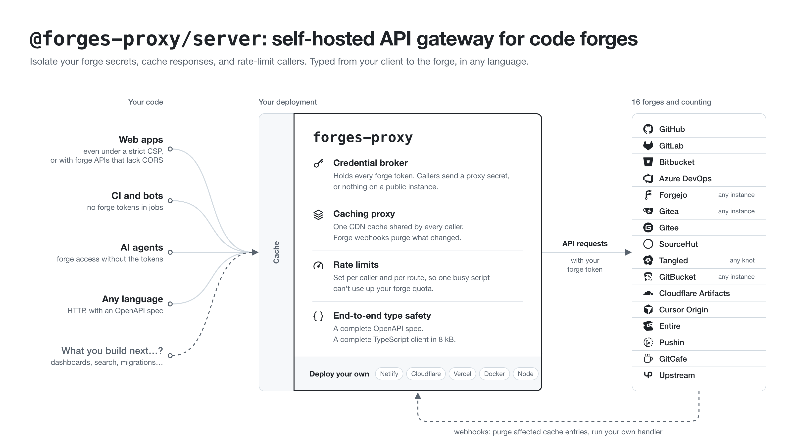

# @forges-proxy/server

<picture>
  <source media="(prefers-color-scheme: dark)" srcset="https://raw.githubusercontent.com/serhalp/forges-proxy/main/assets/server-dark.png">
  
</picture>

A self-hostable credential broker for [`forges`](https://forges.link), as a [Fetchable](https://fetchable.org): one API, one cache, and one set of credentials in front of every forge you configure.

```sh
pnpm add @forges-proxy/server
```

Where your platform takes a Fetchable, this is the whole entry:

```ts
export { default } from "@forges-proxy/server"
```

Configure it with `FORGES_*` environment variables, and pass platform specifics (CDN headers, purging, the providers' `fetch`) to `createServer()`. See the [README](https://github.com/serhalp/forges-proxy#readme) for configuration and the API, and [`demos/`](https://github.com/serhalp/forges-proxy/tree/main/demos) for Netlify, Cloudflare Workers, Vercel, Node, Docker, Hono, Nitro, and Fastify.
